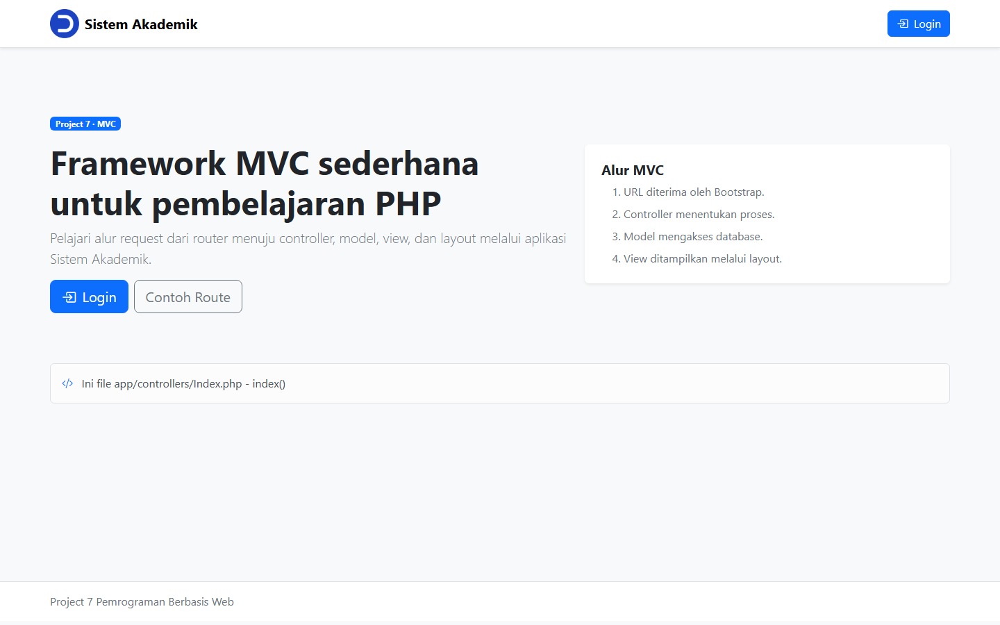
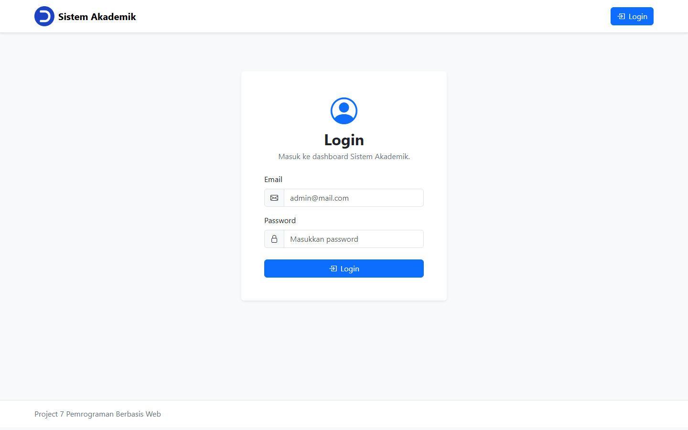
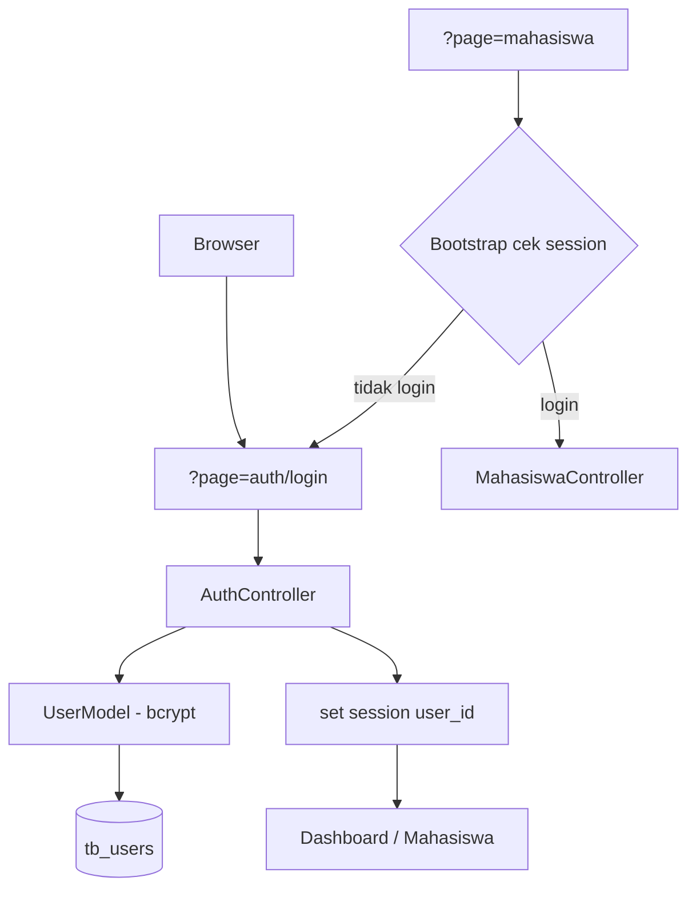

<div align="center">

# 🔐 Sistem Akademik — Project 7

**Project 7 · MVC + Login & CRUD User**

Pengembangan Project 6 dengan **autentikasi session**, halaman terlindungi, dan CRUD User.

     

</div>

---

## 📖 Deskripsi

`Bootstrap.php` memeriksa `$_SESSION['user_id']`: halaman `Index` dan `Auth` boleh diakses tamu, selain itu diarahkan ke `auth/login`. Password disimpan dengan `password_hash()` (bcrypt). Tabel `tb_users` ditambahkan di samping tabel akademik.

## 📸 Tampilan

<table>
  <tr>
    <td width="50%"><br><sub>Beranda / Landing</sub></td>
    <td width="50%"><br><sub>Halaman Login</sub></td>
  </tr>
</table>

## ✨ Fitur

- 🔑 Login & logout dengan session + bcrypt
- 🛡️ Proteksi halaman (redirect ke login)
- 👤 CRUD User (`tb_users`)
- 📋 CRUD Mahasiswa, Dosen, Matakuliah
- 📊 Dashboard setelah login
- 🧭 Router MVC + `.htaccess`
- 🛑 Halaman 404

## 🧱 Teknologi

| Lapisan | Teknologi |
| --- | --- |
| Arsitektur | MVC buatan sendiri |
| Auth | Session + `password_hash` (bcrypt) |
| Database | MySQL (PDO), `tb_users` |
| Routing | `mod_rewrite` → `?page=` |
| Autoload | Composer PSR-4 |

## 🏗️ Arsitektur



## 🚀 Instalasi

1. Import `database.sql` ke `pbwl_samples_7` ( terdapat `tb_users` ).
2. Buat akun lewat modul **User** atau register bila tersedia.
3. Buka **http://localhost/project7/** lalu login.

## 🗂️ Struktur

```
project7/
├── app/
│   ├── core/        # Bootstrap (guard session), Controller, Model
│   ├── controllers/ # Auth, Dashboard, User, Mahasiswa, Dosen, Matakuliah
│   ├── models/      # User, Mahasiswa
│   └── views/       # auth/login, user/*, dashboard, dll
├── inc/
├── layouts/
├── .htaccess
├── database.sql
├── index.php
└── README.md
```

## 🗄️ Database

Database **`pbwl_samples_7`** di MySQL/MariaDB port **3307** (user `root`, password kosong).

File `database.sql` sudah diimpor. Jika perlu import ulang:

```bash
mysql -h 127.0.0.1 -P 3307 -u root pbwl_samples_7 < database.sql
```

> Database lain di XAMPP (termasuk `dbakademik`) sengaja tidak disentuh.

## ✅ Verifikasi

- `/` → 200 (beranda)
- `/?page=auth/login` → 200
- Halaman lain dialihkan ke login bila belum login

## 🔗 Tautan

- GitHub: https://github.com/Neuron700/project-pbwl-7
- Aplikasi: http://localhost/project7/

## 📄 Lisensi

MIT
